<!--
  Five a.m. offshore —
  the pager sleeps, the swell builds.
  All green. I paddle.

  If you're reading the raw source, we'll get along. → gustavohuds@gmail.com
  (The art and the pipeline that turns it into themed, animated SVG live in /build.)
-->

<div align="center">

<picture>
  <source media="(prefers-color-scheme: dark)" srcset="./assets/hero-dark.svg">
  <source media="(prefers-color-scheme: light)" srcset="./assets/hero-light.svg">
  
</picture>

**CTO who builds.** I find the real business problem, ship the system that solves it<br/>
and keep it running in production, across retail, fintech and entertainment.

<a href="mailto:gustavohuds@gmail.com"><picture><source media="(prefers-color-scheme: dark)" srcset="./assets/btn-email-dark.svg"><source media="(prefers-color-scheme: light)" srcset="./assets/btn-email-light.svg"></picture></a>
<a href="https://linkedin.com/in/gustavohsn"><picture><source media="(prefers-color-scheme: dark)" srcset="./assets/btn-linkedin-dark.svg"><source media="(prefers-color-scheme: light)" srcset="./assets/btn-linkedin-light.svg"></picture></a>
<a href="https://lojasbelmont.com.br"><picture><source media="(prefers-color-scheme: dark)" srcset="./assets/btn-live-dark.svg"><source media="(prefers-color-scheme: light)" srcset="./assets/btn-live-light.svg"></picture></a>
<a href="https://github.com/GustavoHuds/Ttalk_bot_manager"><picture><source media="(prefers-color-scheme: dark)" srcset="./assets/btn-oss-dark.svg"><source media="(prefers-color-scheme: light)" srcset="./assets/btn-oss-light.svg"></picture></a>

<sub>João Pessoa, Brazil &nbsp;·&nbsp; remote or on-site &nbsp;·&nbsp; Portuguese & English &nbsp;·&nbsp; open to projects & partnerships</sub>

</div>

<picture><source media="(prefers-color-scheme: dark)" srcset="./assets/divider-dark.svg"><source media="(prefers-color-scheme: light)" srcset="./assets/divider-light.svg"></picture>

## 壱 · In production

<!-- telemetry:start -->
<picture>
  <source media="(prefers-color-scheme: dark)" srcset="https://telemetry.72-60-241-1.sslip.io/telemetry.svg?theme=dark">
  <source media="(prefers-color-scheme: light)" srcset="https://telemetry.72-60-241-1.sslip.io/telemetry.svg?theme=light">
  
</picture>
<!-- telemetry:end -->

<div align="center">

| **15+** | **8 stores** | **2,000+** | **1,600+** |
|:---:|:---:|:---:|:---:|
| systems designed, built<br/>and run in production | plus a distribution center<br/>running on my software | automated tests in a<br/>single platform (BELeads) | SKUs unified into one<br/>catalog by my data pipeline |

</div>

## 弐 · About

I'm the **CTO of Lojas Belmont**, a furniture and mattress retail chain in Paraíba, Brazil. I own the whole technology function: strategy, architecture, code, infrastructure, security and support. When HR, sales, marketing, inventory or operations hits a problem, I scope it, build the system and keep it running.

Outside retail I've shipped platforms for fintech and entertainment to the same standard: documented, tested, monitored.

I use AI as part of how the business runs, not only to write code:

| | |
|---|---|
| **Engineering** | Multi-agent workflows that plan, implement, review and test, behind the same CI gates as human code |
| **Sales** | Leads extracted from WhatsApp and Instagram, service scoring per conversation, a weekly coaching report per seller |
| **Data** | Supplier PDFs, price tables and ERP exports turned into clean, deduplicated datasets |
| **Marketing** | Product photography, campaign creatives and consumer-law (CDC) review of promotions before print |

## 参 · Work by sector

> Every system below was designed, built, deployed and operated by me. Most are private company systems; technical walkthroughs are available on request.

### <picture><source media="(prefers-color-scheme: dark)" srcset="./assets/kamon-retail-dark.svg"><source media="(prefers-color-scheme: light)" srcset="./assets/kamon-retail-light.svg"></picture> Retail · Lojas Belmont

<table>
<tr>
<td width="50%" valign="top">

#### BELPonto
**Workforce and time-attendance compliance**

Multi-company platform with store kiosks, a mobile PWA, geolocation, hours calculation, HR workflows, digital signatures and an immutable audit trail.

- 53 architecture decision records, 26 security requirements
- PostgreSQL row-level security per company
- Async workers: outbox, daily seal, data retention

`NestJS` `React PWA` `Prisma` `PostgreSQL` `MinIO`

</td>
<td width="50%" valign="top">

#### BELeads
**B2B prospecting and lead generation**

Collects companies from Google Maps by municipality, deduplicates and enriches them, and feeds a mobile call queue for the sales team.

- 2,000+ automated tests behind 5 CI gates (Gitleaks, Semgrep, Trivy, E2E)
- Claude-assisted lead handling with human confirmation
- Public-tender monitoring with Telegram alerts

`NestJS` `React` `pg-boss` `Prisma` `PostgreSQL` `Claude`

</td>
</tr>
<tr>
<td width="50%" valign="top">

#### [Lojas Belmont website](https://lojasbelmont.com.br)
**The chain's storefront**

Product catalog, nearest-store routing, weekly promotions, an admin panel for marketing, Google-review campaigns, NPS surveys and local SEO for every store.

- Lighthouse 94+ with an optimized image pipeline
- Runs in production at lojasbelmont.com.br

`Next.js` `Prisma` `PostgreSQL` `Sharp`

</td>
<td width="50%" valign="top">

#### ExtractNeoron
**Sales intelligence**

Pulls every lead from WhatsApp, Instagram DM and web chat, ranks the pipeline by urgency and builds the 24-hour call-back queue.

- Conversion, first-response time and ticket metrics per seller
- AI service score per conversation and a weekly coaching report

`Node.js` `Express` `Firebase` `Claude Agent SDK`

</td>
</tr>
</table>

| Also in retail | What it does | Stack |
|---|---|---|
| **BELPreço** | Price posters and shelf labels with brand templates and Code 128 barcodes. Any employee prints a correct poster in under a minute. | React · TypeScript · Vite |
| **Catalog pipeline** | Consolidates supplier price PDFs and ERP exports into a 1,600+ SKU catalog. | Python · PDF parsing |
| **BINAH** | Internal knowledge base: procedures, troubleshooting and AI search. | React |

### <picture><source media="(prefers-color-scheme: dark)" srcset="./assets/kamon-fintech-dark.svg"><source media="(prefers-color-scheme: light)" srcset="./assets/kamon-fintech-light.svg"></picture> Fintech

| Project | What it does | Stack |
|---|---|---|
| **NinjaCash** | Lending management: client portal, PIX payments, credit scoring and automated WhatsApp reminders. | Next.js · Express · PostgreSQL |

### <picture><source media="(prefers-color-scheme: dark)" srcset="./assets/kamon-entertainment-dark.svg"><source media="(prefers-color-scheme: light)" srcset="./assets/kamon-entertainment-light.svg"></picture> Entertainment

| Project | What it does | Stack |
|---|---|---|
| **Txintxa do Gigi** | Influencer affiliate platform with raffles and live bingo: real-time draws, payment validation and analytics. | NestJS · React · BullMQ · Socket.IO |

### <picture><source media="(prefers-color-scheme: dark)" srcset="./assets/kamon-platforms-dark.svg"><source media="(prefers-color-scheme: light)" srcset="./assets/kamon-platforms-light.svg"></picture> Platforms, infra & open source

| Project | What it does | Stack |
|---|---|---|
| **Belmont Monitor** | Private observability and security stack: uptime, logs, intrusion detection, 2FA panels, tested daily backups and an on-call Telegram bot, in about 420 MB of RAM. | Docker · Caddy · Authelia · CrowdSec |
| **[Ttalk Bot Manager](https://github.com/GustavoHuds/Ttalk_bot_manager)** `OSS` | Self-hosted WhatsApp bots for small businesses, managed from one web panel. | TypeScript · Fastify · Baileys · SQLite |
| **Cockpit** | Local-first engineering cockpit: watches Git repos, analyzes progress with Claude and forecasts delivery. | Fastify · Next.js · Prisma |
| **MAPservice** | Service management with WhatsApp messaging, campaigns and rate limiting that keeps numbers from being banned. | FastAPI · Next.js · PostgreSQL |

## 肆 · How I ship

| 段取り **Dandori** · *preparation* | 検証 **Kenshō** · *verification* | 改善 **Kaizen** · *continuous improvement* |
|---|---|---|
| *"Preparation is 80% of the work."* Scope and acceptance criteria, architecture decision records, security requirements per system. | Unit, integration and E2E tests. Secret, SAST and container scanning. Review on every change, staged rollouts with a rollback plan. | Monitoring, alerts and an on-call bot. Backups with restore drills. Runbooks and user manuals. Every incident leaves the system stronger. |

## 伍 · Stack

<picture>
  <source media="(prefers-color-scheme: dark)" srcset="./assets/stack-dark.svg">
  <source media="(prefers-color-scheme: light)" srcset="./assets/stack-light.svg">
  
</picture>

<sub>Only what runs in production today. Also: Java, networking (LAN/WAN, Wi-Fi surveys, VPN), retail hardware and ERP integration over API, SOAP, files and RPA.</sub>

## 陸 · Activity

<picture>
  <source media="(prefers-color-scheme: dark)" srcset="https://raw.githubusercontent.com/GustavoHuds/gustavohuds/output/activity-dark.svg">
  <source media="(prefers-color-scheme: light)" srcset="https://raw.githubusercontent.com/GustavoHuds/gustavohuds/output/activity-light.svg">
  
</picture>

<sub>Redrawn every morning by a GitHub Action. Most of my work lives in private company repositories; the count includes private activity.</sub>

<picture><source media="(prefers-color-scheme: dark)" srcset="./assets/divider-dark.svg"><source media="(prefers-color-scheme: light)" srcset="./assets/divider-light.svg"></picture>

<details>
<summary><b>Off-duty</b></summary>

<br/>

```console
$ cto --off-duty
> status ........ offline (by choice)
> sea ........... dawn sessions when the swell shows up
> land .......... trails, mountains, anything with a view at the top
> road .......... two wheels or four, windows down
> belief ........ the best architecture ideas show up 1.5 m offshore at 5 a.m.
```

<picture>
  <source media="(prefers-color-scheme: dark)" srcset="./assets/offduty-dark.svg">
  <source media="(prefers-color-scheme: light)" srcset="./assets/offduty-light.svg">
  
</picture>

</details>

<br/>

<div align="center">

<picture>
  <source media="(prefers-color-scheme: dark)" srcset="./assets/footer-dark.svg">
  <source media="(prefers-color-scheme: light)" srcset="./assets/footer-light.svg">
  
</picture>

### Have a problem worth solving? [Let's talk.](mailto:gustavohuds@gmail.com)

<sub>Ink art made with AI image tools, then traced, themed and animated in code ([/build](./build)) · fonts: Shippori Mincho & JetBrains Mono (OFL) · icons: Simple Icons (CC0)</sub>

</div>

<!--
            _.====.._
          ,:._       ~-_
              `\        ~-_
                | 竜門       `.
              ,/             ~-_
     -..__..-''                 ~~--..__
  the koi that climbs the falls becomes a dragon.
-->
